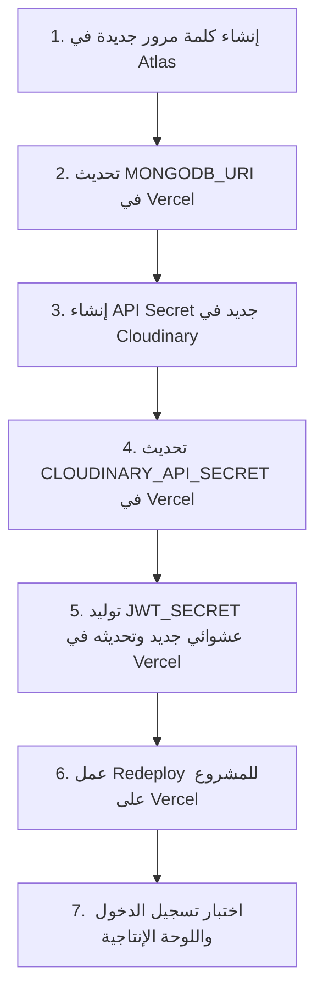

# IT-SPARK Academy – Security Operations & Incident Runbook
## دليل العمليات الأمنية وإجراءات التشغيل القياسية (SOP)

- **Organization**: IT-SPARK Academy (`https://www.itsparkacademy.com/`)
- **Version**: 2.0 (Post-Incident Hardened Standard)
- **Target Audience**: DevOps Engineers, Security Administrators, Platform Maintainers

---

## 1. How to Monitor Security Continuously (كيفية المراقبة الأمنية المستمرة)

### 1.1 Automated Health & Security Status API
يوفر النظام نقطة نهاية تدقيق مشفرة ومحمية لا يمكن استدعاؤها إلا بواسطة حساب الـ Admin:
- **المسار**: `GET /api/admin/security/status`
- **الاستخدام**:
  ```bash
  curl -H "Authorization: Bearer <ADMIN_JWT_TOKEN>" https://www.itsparkacademy.com/api/admin/security/status
  ```
- **ما تقوم النقطة بفحصه**:
  - التأكد من تعيين وحماية كافة متغيرات البيئة (`JWT_SECRET`, `MONGODB_URI`, `CLOUDINARY_*`).
  - فحص حسابات الـ Admin في قاعدة البيانات والتأكد من عدم وجود أي حساب إداري غريب غير معروف.
  - فحص محتويات الكورسات والتأكد من عدم حقن أي كود خبيث (`<script>`, `<iframe src="malicious">`).

### 1.2 Automated Audit Log Review
يقوم النظام بتسجيل كافة الأحداث الحساسة في كولكشن `AuditLog` في MongoDB Atlas:
- محاولات تسجيل الدخول الناجحة والفاشلة (`AUTH_LOGIN_SUCCESS`, `AUTH_LOGIN_FAILED`).
- محاولات ترقية الصلاحيات غير المصرح بها (`PRIVILEGE_ESCALATION_ATTEMPT`).
- محاولات رفع ملفات بامتدادات مشبوهة (`UPLOAD_BLOCKED`).
- **المسار الإداري لاستعراض السجلات**:
  `GET /api/admin/audit-logs?limit=50&page=1`

### 1.3 Local Pre-Deployment Security Audit Script
قبل نشر أي كود جديد إلى فرع الإنتاج `main`، قم بتشغيل سكريبت التدقيق الأمني المحلي:
```bash
node scripts/security-audit.mjs
```
هذا السكريبت يتحقق آلياً من:
1. عدم حظر روبوتات محركات البحث عن مسارات النماذج والمصادقة في `robots.txt`.
2. استمرار تفعيل التحويل الدائم لمسار `/payment`.
3. خلو الكود من دوال `eval()` أو `new Function()`.
4. فرض التحقق والمصادقة على كافة مسارات `app/api/admin/*`.
5. صرامة سياسة أمان المحتوى (CSP) وخلوها من `'unsafe-eval'`.
6. غياب أي أبواب خلفية للتسجيل السري.

### 1.4 Checking Google Safe Browsing Verdict
للتحقق من تصنيف النطاق الحي لدى Google في أي وقت:
```bash
node scripts/verify-safe-browsing.mjs
```
أو زيارة تقرير الشفافية مباشرة:
`https://transparencyreport.google.com/safe-browsing/search?url=https%3A%2F%2Fwww.itsparkacademy.com`

---

## 2. How to Rotate Credentials (دليل تدوير المفاتيح وكلمات المرور)

عند الشك في تسريب أي مفتاح أو بعد أي حادث أمني، اتبع هذا التسلسل الدقيق لمنع انقطاع الخدمة:

### 2.1 Rotation Sequence (التسلسل الآمن)



### 2.2 Detailed Steps

#### أ. تدوير كلمة مرور قاعدة البيانات (MongoDB Atlas):
1. سجل الدخول إلى [MongoDB Atlas Console](https://cloud.mongodb.com/).
2. توجه إلى **Security** > **Database Access**.
3. ابحث عن المستخدم الإنتاجي (`mt7592546_db_user`)، واضغط على **Edit** > **Edit Password**.
4. اضغط على **Autogenerate a Very Secure Password**، وانسخ كلمة المرور الجديدة.
5. في قائمة **Network Access**، تأكد من حصر عناوين IP أو استخدام إعداد الوصول المعتمد لمنصات Serverless.
6. توجه إلى **Vercel Project Settings** > **Environment Variables**.
7. عدّل قيمة `MONGODB_URI` واستبدل كلمة المرور القديمة بالجديدة.

#### ب. تدوير مفاتيح Cloudinary:
1. سجل الدخول إلى [Cloudinary Dashboard](https://cloudinary.com/console).
2. اضغط على أيقونة الإعدادات (Gear Icon) > **Access Keys**.
3. اضغط على **Generate New API Key & Secret**.
4. انسخ `API Secret` الجديد.
5. حدّث `CLOUDINARY_API_SECRET` في **Vercel Environment Variables**.
6. بعد نجاح الـ Deploy الجديد، يمكنك حذف المفتاح القديم بأمان من لوحة Cloudinary.

#### ج. تدوير مفتاح تشفير الجلسات (JWT_SECRET):
1. قم بتوليد مفتاح عشوائي مشفر قوي عبر موجه الأوامر:
   ```bash
   node -e "console.log(require('crypto').randomBytes(32).toString('hex'))"
   ```
2. في **Vercel Project Settings** > **Environment Variables**، عدّل قيمة `JWT_SECRET`.
3. هذا الإجراء سيقوم تلقائياً وفورياً بإلغاء مفعول أي توكنات JWT سابقة وإجبار أي جلسة قديمة على إعادة تسجيل الدخول النظيف.

---

## 3. How to Investigate Future Incidents (إجراءات التحقيق في أي حادث مستقبلي)

إذا تم الإبلاغ عن أي نشاط غير طبيعي أو تحذير جديد، التزم بـ **بروتوكول الاستجابة الصارم**:

### الخطوة 1: الحفاظ على الأدلة الرقمية (Preserve Forensic Evidence)
- **لا تقم بتشغيل أوامر حذف أو تعديل جماعية على الإنتاج**.
- خذ نسخة احتياطية فورية من MongoDB قبل أي تدخل برمجي باستخدام السكريبت المعتمد:
  ```bash
  node scripts/backup-db.mjs
  ```
- احفظ الـ Commit الحالي وسجلات الـ Build على Vercel.

### الخطوة 2: فحص سلامة قاعدة البيانات
- شغل سكريبت فحص سلامة الـ Dump:
  ```bash
  node scripts/inspect-db-dump.js
  ```
- تحقق من عدم ظهور أي روابط خارجية غير معروفة أو وسوم `<script>` أو `<iframe>`.

### الخطوة 3: فحص استجابات الموقع الحي (Live Probing)
- اختبر استجابة السيرفر عبر سكريبت فحص المتصفحات والروبوتات:
  ```bash
  node scripts/probe-live-site.mjs
  ```
- قارن حجم الصفحة والـ Status Code للتأكد من عدم وجود أي سلوك إخفاء (Cloaking).

---

## 4. How to Recover a Clean Deployment (دليل استعادة النسخة النظيفة)

في حال حدوث أي خطأ في النشر أو اشتباه في تلوث الكود الإنتاجي:

1. **الرجوع لآخر Commit نظيف ومعتمد**:
   ```bash
   git log -n 5 --oneline
   ```
2. **التحقق من اجتياز الفحص الأمني الآلي**:
   ```bash
   node scripts/security-audit.mjs
   ```
3. **تنفيذ Build نظيف بدون كاش**:
   ```bash
   npm run build
   ```
4. **النشر إلى Vercel من فرع main النظيف**:
   - يتم النشر تلقائياً بمجرد عمل `git push origin main`.
   - أو عبر Vercel Dashboard بالضغط على **Deployments** > **Redeploy**.

---

## 5. How to Respond to Google Safe Browsing Warnings (دليل التعامل مع تحذيرات Google)

إذا ظهر تحذير أمني من Google Safe Browsing:

1. **لا تقدم طلب مراجعة سريع بدون إصلاح جذري**:
   - طلبات المراجعة المتسرعة تؤدي إلى تكرار الحظر وفرض فترات انتظار أطول (Cool-down Periods).
2. **تحقق من تقرير Search Console**:
   - ادخل إلى [Google Search Console](https://search.google.com/search-console).
   - انتقل إلى **Security Issues**.
   - سجّل بدقة الروابط المذكورة في تقرير العينات (Sample URLs).
3. **تأكد من إمكانية زحف Googlebot**:
   - ادخل إلى **URL Inspection** في Search Console واطلب فحص الرابط المذكور عبر **Test Live URL**.
   - تأكد أن حالة الصفحة: `URL is available to Google` ولا يوجد أي اعتراض من `robots.txt`.
4. **تأكد من غياب أي نماذج وهمية أو محاكاة دفع غير مكتملة**.
5. **قدّم طلب المراجعة الرسمي** باستخدام النموذج الموثق في القسم 9 من تقرير `SECURITY-INCIDENT-REPORT.md`.
